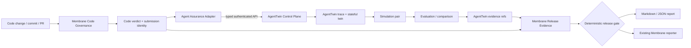

# MEMBRANE AI — Agent Assurance Integration Plan

**Status:** Planning baseline committed; implementation not started  
**Date:** 2026-10-30  
**Execution brief:** [CLAUDE.md](CLAUDE.md)  
**Research:** [combined research and demo report](../research/MembraneAI_AgentTwin_Birlesik_Platform_Arastirma_ve_Demo_Tasarimi.md)  
**Live status:** [PROGRESS.md](PROGRESS.md)

---

## 1. Product outcome

Build an Agent Assurance capability under Membrane AI. Membrane remains the system that owns code governance, organization/project identity, release aggregation and external SCM reporting. AgentTwin remains the system that owns agent traces, scenarios, digital twins, simulations and detailed evaluation evidence.

The integration is successful when a Membrane release record links an immutable code verdict to a pinned AgentTwin baseline/candidate evaluation and produces a deterministic, explainable PASS/WARN/BLOCK result with evidence links.

## 2. Baseline and repository ownership

| Concern | Membrane AI | AgentTwin |
|---|---|---|
| Primary role | Code Governance / platform governance | Agent Assurance reference platform |
| Main runtime | Go services + Python semantic service | Go control/trace/graph/gateway; Python simulation/evaluation; Next.js UI |
| Event backbone | Redpanda/Kafka | RabbitMQ |
| Database | PostgreSQL/Aurora + pgvector (per current docs) | PostgreSQL + pgvector |
| Telemetry | OpenTelemetry across Membrane services | OpenTelemetry GenAI SDK/collector/trace service |
| Demo | CLI Code Sweeper / governance | Demo Co support-refund agent |
| First integration | typed API client + evidence aggregator | stable external API contract + evaluation reference |

**Rule:** do not consolidate event buses or databases in the first integration. Avoid repo migration.

## 3. Logical architecture and ownership

### Data ownership

| Data | Authoritative owner | Membrane stores |
|---|---|---|
| Organization/project identity | Membrane | canonical ID + explicit AgentTwin mapping |
| Code submission, commit, PR, code verdict | Membrane | full authoritative record |
| Agent manifest/version | AgentTwin | version/hash/reference snapshot |
| Trace spans and content | AgentTwin | trace ID/link + minimal summary only |
| Twin/scenario definition and state diffs | AgentTwin | immutable version references + minimal gate evidence |
| Simulation/evaluation runs | AgentTwin | run/evaluation IDs, status, pinned versions/seeds, verdict summary, links |
| Combined release decision | Membrane | immutable decision and evidence index |
| Runtime action authorization | reviewed runtime boundary | policy reference/audit link; do not duplicate enforcement prematurely |

## 4. Versioned integration contracts

Claude must inspect AgentTwin's actual OpenAPI schemas and APIs before finalizing the contract. The following is the required logical shape, not a claim that these exact endpoints or JSON names already exist.

### 4.1 Mapping record

Minimum fields:

- `mapping_id`
- `membrane_org_id`, `membrane_project_id`
- `agenttwin_org_id`, `agenttwin_project_id`
- `agenttwin_base_url` (server-side allowlisted configuration; never user-controlled arbitrary URL)
- credential reference (secret-manager/environment key name only; never plaintext)
- mapping status, timestamps, actor and audit reference
- optional default agent ID / demo agent ID

### 4.2 Release evidence record

Minimum logical fields:

- `schema_version`
- `release_id`, `correlation_id`, creation time
- Membrane organization/project, repository, submission ID, commit SHA and optional PR number
- code-governance verdict, ruleset version, findings summary and canonical evidence URL
- agent ID, baseline version, candidate version, manifest/prompt hashes
- AgentTwin project ID, evaluation run ID, paired simulation IDs, scenario selection, run seed and engine/evaluator versions
- overall AgentTwin status and per-scenario status/severity summary
- critical failure IDs and evidence URLs (trajectory, state diff, verified outcome, first divergence)
- judge provider/model/prompt hash/calibration status when semantic judges are involved
- combined gate decision and triggered rule IDs
- source timestamps, immutable snapshot hash and audit metadata

Keep the snapshot minimal. Do not persist raw span content, prompt text, raw tool payloads or PII by default.

### 4.3 Status mapping

| AgentTwin status / condition | Integration status | Gate consequence |
|---|---|---|
| Paired evaluation completed, all required critical scenarios pass | `COMPLETED` | Candidate may PASS if code/policy gates also pass |
| Critical deterministic scenario fails | `COMPLETED_WITH_CRITICAL_FAILURE` | BLOCK |
| Non-critical scenario fails | `COMPLETED_WITH_REGRESSION` | WARN or BLOCK by explicit policy |
| Evaluation worker failed / provider error / malformed evidence | `ERROR` | never PASS |
| Missing run, missing side, mismatched suite/seed | `INCOMPLETE` | never PASS |
| Pending/running | `PENDING` | no final PASS |
| Agent assurance optional and not configured | `NOT_CONFIGURED` | N/A or WARN, explicit |
| Agent assurance required but mapping unavailable | `BLOCKED` / `INCOMPLETE` | never PASS |

### 4.4 Correlation model

Carry trusted metadata where supported:

- `membrane.organization_id`
- `membrane.project_id`
- `membrane.release_id`
- `membrane.code_submission_id`
- `membrane.repository`
- `membrane.commit_sha`
- `membrane.pull_request_number`
- `membrane.agent_id`
- `membrane.agent_version`
- `membrane.change_set_id`
- `membrane.correlation_id`
- W3C `traceparent` / `tracestate`

Business release ID and trace ID are distinct. Tenant identity must come from authenticated credentials/mapping, not agent attributes.

## 5. Deterministic release gate rules

Rules must be versioned and table-tested.

| Rule ID (suggested) | Condition | Result |
|---|---|---|
| `CODE_CRITICAL` | Membrane verdict has blocking/critical finding | BLOCK |
| `AGENT_CRITICAL_SCENARIO` | Any required critical AgentTwin scenario fails | BLOCK |
| `UNSAFE_IRREVERSIBLE_ACTION` | Unauthorized or duplicate irreversible side effect | BLOCK |
| `OUTCOME_CONTRADICTION` | Agent claims success but verified state proves failure | BLOCK |
| `TENANT_BOUNDARY_VIOLATION` | Cross-tenant access or identity spoofing | BLOCK |
| `POLICY_BYPASS` | Required approval or policy check skipped | BLOCK |
| `AGENT_EVAL_INCOMPLETE` | Required paired evaluation missing, mismatched, errored or incomplete | BLOCK, or explicit WARN only when policy says optional; never silent PASS |
| `NONCRITICAL_REGRESSION` | Non-critical scenario regresses | WARN |
| `UNCALIBRATED_JUDGE` | Critical semantic finding from uncalibrated judge | WARN + human review |
| `COST_LATENCY_REGRESSION` | Cost/latency delta over warning threshold | WARN |
| `COVERAGE_GAP` | Relevant tool/policy/failure-mode coverage insufficient | WARN/BLOCK by policy |
| `OPTIONAL_ASSURANCE_UNAVAILABLE` | Assurance is optional but unavailable | WARN/N/A with reason |

No numeric risk score may override a hard BLOCK. Any risk index must expose its formula and must not be called a probability.

## 6. Phases and exit criteria

### Phase 0 — Baseline revalidation — DONE (2026-10-30)

- [x] Confirm current Membrane `main` SHA and integration branch state. (`main` @ `aedc1ed`; `feature/agenttwin-assurance` absent — owner directed work on `main`.)
- [x] Confirm current AgentTwin `main` SHA and implementation-board status. (`1e8fd0e`; README Phases 0–3 done, graph/release-gate/regression-miner/runtime-gateway pending.)
- [x] Read AgentTwin OpenAPI routes, API key scopes and authentication. (4 OpenAPI docs; `bearerAuth`+`X-AgentTwin-Api-Key`; `Idempotency-Key` on mutations; paired pinning `/internal/v1/simulation-pairs` + `/api/v1/eval-runs`; live-probed.)
- [x] Run feasible Membrane local quality gates. (build/test/lint/eval/lint:py/test:py/build:cli PASS; helm:lint BLOCKED — no helm.)
- [x] Reproduce AgentTwin refund baseline/candidate pair; record actual results. (1.2.4=9/9; 1.3.0=6/9/2 critical; 1.3.1=9/9. See PROGRESS.md §7/§9.)
- [x] Record blockers and update `PROGRESS.md`. (Docker Hub 429 → mirror.gcr.io; go1.25 SDK for covdata; helm absent.)

**Exit:** evidence-backed current-state inventory and repeatable demo baseline. **Met.**

### Phase 1 — Contract, mapping and threat model — DONE (2026-10-30)

- [x] Choose integration boundary inside Membrane. (Orchestrator composition root, not a new service; ADR-0001 #3. Pure contract in `pkg/assurance` now; port+adapter in Phase 2.)
- [x] Define mapping and evidence contracts with schema versioning. (`pkg/assurance`: `MappingRecordV1`/`ReleaseEvidenceV1`/`CorrelationContext`, all `schema_version=1.0.0`; JSON Schemas under `pkg/assurance/contracts/`.)
- [x] Record ADR for independent data ownership and HTTP-first integration. (`ADR-0001-agent-assurance-integration.md`; `docs/DECISIONS.md` D-037.)
- [x] Define auth, tenant scoping, URL allowlist, TLS, timeouts, size bounds, retry/idempotency. (`THREAT_MODEL.md` T1–T12; `Allowlist` + credential-by-reference + status/idempotency contract shipped; timeouts/size/redirect are Phase-2 adapter code, designed here.)
- [x] Add fixtures and compatibility checks. (`contracts/fixtures/*` incl. the real 1.3.0/1.3.1 runs; pinned AgentTwin OpenAPI snapshot; `compat_test.go` — pkg/assurance 93.7% coverage, `task test`/`task lint` green.)
- [x] Document upstream AgentTwin gaps without changing its repo. (Cross-project service credential open item recorded; AgentTwin untouched.)

**Exit:** tested contract and threat model; no shared DB/event bus. **Met** (contract tests green; HTTP-only, no shared DB/bus).

### Phase 2 — AgentTwin client and vertical slice — DONE (2026-10-30)

- [x] Add typed client port and HTTP adapter in appropriate Membrane module. (`pkg/assurance`: `AgentTwinClient` port + `HTTPClient`.)
- [x] Add configuration and secret reference handling. (`HTTPConfig` base URL+key from config/env; never logged; allowlist-checked.)
- [x] Add fake adapter and fake HTTP server tests. (`FakeClient` + `httpclient_test.go`: 2xx/401/403/404/409/429/5xx/malformed/timeout/config/allowlist.)
- [x] Invoke a real AgentTwin evaluation/pair using verified actual routes. (Live: `GET /api/v1/eval-runs/{id}` → real 1.2.4→1.3.0 run `01a18dc0…`.)
- [ ] Persist minimal immutable evidence snapshot. (Phase 3 — currently produced on demand, not persisted.)
- [x] Link code submission, commit and agent evaluation with correlation ID. (`BuildReleaseEvidence` correlates code verdict + agent eval.)
- [x] Provide one reproducible demo command/task. (`pkg/cmd/release-evidence` + `task release-evidence`.)

**Exit:** one command produces code + agent evidence in one Membrane report. **Met** (offline `--fake` + live, gate BLOCK with both rules). Persistence carried to Phase 3.

### Phase 3 — Evidence aggregation and gate — DONE (2026-10-30)

- [x] Implement deterministic gate rules and table-driven tests. (`combinedGate` + `gate_rules_test.go` exhaustive matrix.)
- [x] Ensure error/incomplete/missing required evidence cannot pass. (PASS only for clean COMPLETED; store refuses invalid records.)
- [x] Generate Markdown and JSON. (`RenderJSON`/`RenderMarkdown`, canonical.)
- [x] Include source hyperlinks and pinned version/seed metadata. (Evidence carries eval run id, seed, versions, scenario/evidence URLs.)
- [x] Make report regeneration deterministic. (`--store`/`--regenerate` → byte-identical JSON+MD; immutable `EvidenceStore`.)

**Exit:** every decision can be independently audited. **Met** (immutable persisted evidence + deterministic regeneration + fail-safe gate, all tested).

### Phase 4 — SCM shadow mode — DONE (2026-10-30)

- [x] Reuse reporter, status and idempotent delivery patterns. (`MapSCMStatus` mirrors reporter domain + D-035; `GitHubStatusPublisher` reuses the notify HTTP pattern; `IdempotentPublisher` delivery log.)
- [x] Publish combined result in shadow mode first. (`release-evidence --publish-shadow`; shadow is the default, BLOCK→neutral/non-blocking.)
- [x] Test duplicate webhook, retry, timeout, 429, 5xx, missing eval, stale mapping and revoked credentials. (Idempotency test + fake-server 201/401/403/404/5xx; revoked-token → Unauthorized; missing coords → validation.)
- [~] Capture shadow discrepancy metrics. (Outcome + delivered flag surfaced per publish; a metrics counter is deferred to the orchestrator/reporter wiring.)
- [x] Keep enforcement opt-in. (`--enforce`; default is shadow, which never blocks a merge.)

**Exit:** safe, observable, idempotent shadow integration. **Met** (shadow non-blocking, deterministic mapping, idempotent delivery, typed failures — all tested).

### Phase 5 — Demo hardening and handoff — DONE (2026-10-30)

- [x] Add clean setup/reset/run/cleanup procedure. (`DEMO_RUNBOOK.md` §2 bring-up + reset path.)
- [x] Add real screenshots/logs only from an actual run. (Runbook carries real command outputs; dashboard screenshots sent in D2/D5.)
- [x] Test regressed `1.3.0` and fixed `1.3.1` where available. (Live: 1.3.0 → BLOCK, 1.3.1 → PASS; both shadow-published.)
- [x] Run Membrane `task lint`, `task test`, relevant build/eval/contract checks. (All green: 43 ok pkgs, 0 FAIL, 0 lint; dashboard 33+7.)
- [x] Document external AgentTwin runtime and optional provider config. (Runbook §0/§2 + env inventory in NETLIFY.md.)
- [x] Update progress, handover and relevant roadmap/ADR entries. (This commit.)

**Exit:** reproducible cold-start demo and documented limitations. **Met.**

### Dashboard & Netlify delivery — explicit parallel workstream

Follow [DASHBOARD_AND_NETLIFY_WORKFLOW.md](DASHBOARD_AND_NETLIFY_WORKFLOW.md). Its D0–D5 gates cover baseline inventory, dashboard foundation, functional Agent Assurance views, Code Governance integration, Netlify demo readiness and final acceptance. Keep dashboard statuses separate from AgentTwin integration phases. Static demo deployment does not imply connected production readiness.

### Later — do not pre-empt MVP

- [ ] AgentTwin graph/change impact + blast radius.
- [ ] Production regression mining and reviewed promotion.
- [ ] Runtime tool-action governance and approvals.
- [ ] Integrated enterprise tenant/load/chaos/SSRF/retention hardening.

## 7. Test and failure matrix

| Area | Required cases |
|---|---|
| Client/API | 2xx, 400, 401, 403, 404, 409, 429, 5xx, timeout, bad TLS, redirect, malformed/oversized body |
| Auth/tenant | wrong org/project, expired/revoked key, spoofed tenant attributes, unauthorized scope |
| Idempotency | repeated create, lost response/retry, duplicate webhook, concurrent evaluation |
| Evaluation | PASS, critical FAIL, noncritical FAIL, ERROR, INCOMPLETE, CANCELLED, missing side, mismatched pins |
| Gate | each rule alone, multiple rules, critical + good average score, error without failure, missing required evidence |
| Evidence/report | immutable snapshot, deterministic render, redaction, links, no secrets, correct commit/agent version |
| Resilience | AgentTwin unavailable, queue delay, slow judge, budget exhausted, partial provider failure, cancellation |
| Observability | trace propagation, no sensitive attributes, bounded log cardinality |

## 8. Demo acceptance checklist

- [ ] Clean environment can start the supported Membrane and AgentTwin components.
- [ ] Synthetic order/customer/refund data only.
- [ ] Membrane code-governance result visible and correctly scoped.
- [ ] AgentTwin paired run uses identical pinned scenarios and case seeds.
- [ ] At least one regression shown with trajectory + state-diff evidence.
- [ ] Claimed-vs-verified contradiction visible where tested.
- [ ] Combined report identifies code commit, agent versions, evaluation IDs, failures and gate rules.
- [ ] `1.3.1` shown as fixed only if reproduced live.
- [ ] No paid model credentials required for deterministic acceptance.
- [ ] No external live tool/payment side effects possible.
- [ ] Markdown/JSON artifacts reproducibly generated.
- [ ] Limitations explicit.

## 9. Definition of done

The workstream is `DONE` only when Phase 0–5 are complete; the demo is repeatable; code/agent evidence is cross-linked; deterministic gate tests pass; Membrane quality gates pass; the progress report contains SHAs and exact results; and no critical security/privacy issue remains. Later phases may remain planned but must not be marked complete.
